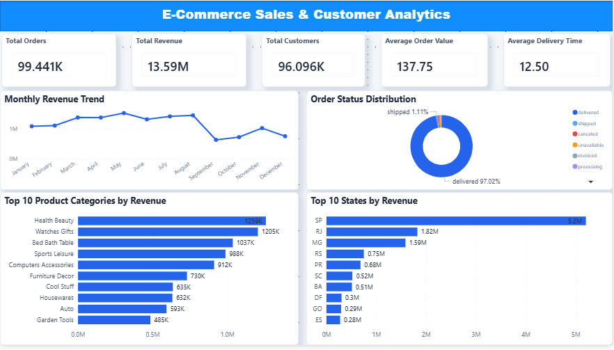
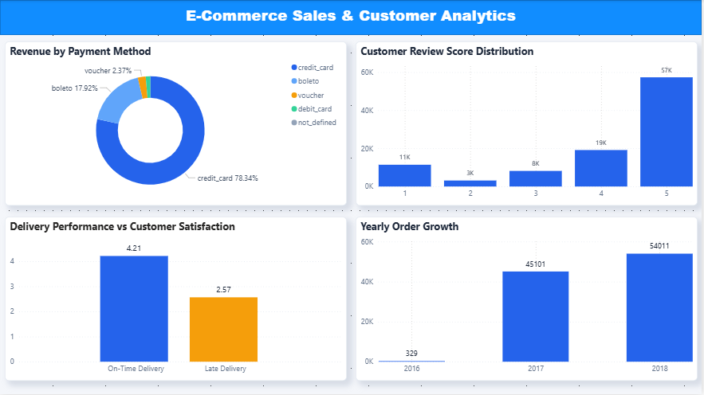

# E-Commerce Sales & Customer Analytics

An end-to-end data analytics project exploring Brazilian e-commerce sales, customer behavior, product performance, and delivery operations using **MySQL and Power BI**.

## Project Overview

The goal of this project is to analyze e-commerce data, identify business trends, and generate actionable insights to support data-driven decision-making.

## Tools & Technologies

- MySQL
- SQL
- Microsoft Power BI
- Power Query
- DAX

## Dataset

**Olist Brazilian E-Commerce Public Dataset**

The dataset contains nine CSV files covering customers, orders, order items, payments, reviews, products, sellers, geolocation, and product category translations.

## Key Performance Indicators

| Metric | Result |
|---|---:|
| Total Orders | 99,441 |
| Total Customers | 96,096 |
| Total Revenue | BRL 13,591,643.70 |
| Average Order Value | BRL 137.75 |
| Average Delivery Time | 12.50 days |

## Key Business Insights

- Health & Beauty was the highest-revenue product category.
- São Paulo generated the highest revenue among customer states.
- Credit cards were the dominant payment method.
- 57.78% of customer reviews were 5-star ratings.
- On-time deliveries had a higher average review score (4.29) than late deliveries (2.57).

## Power BI Dashboard

### Executive Overview

### Customer & Operations

## Project Files

- `Ecommerce_Sales_Analysis.sql` — SQL queries and business analysis.
- `Business_Insights_Report.md` — Findings and business recommendations.
- `E-Commerce_Sales_Analytics_Dashboard.pdf` — Complete Power BI dashboard.
- `Executive_Overview.png` — Dashboard page 1.
- `Customer_Operations.png` — Dashboard page 2.

## Business Recommendations

1. Improve delivery reliability to increase customer satisfaction.
2. Focus marketing strategies on high-revenue product categories.
3. Strengthen sales strategies in high-performing states.
4. Investigate low customer ratings to identify service improvements.
5. Use targeted promotions and product bundles to increase average order value.

## Conclusion

This project demonstrates practical skills in SQL querying, data analysis, data modeling, Power BI dashboard development, and business insight generation.

*Note: The 2018 dataset covers only part of the year, so yearly comparisons should account for this limitation.*
